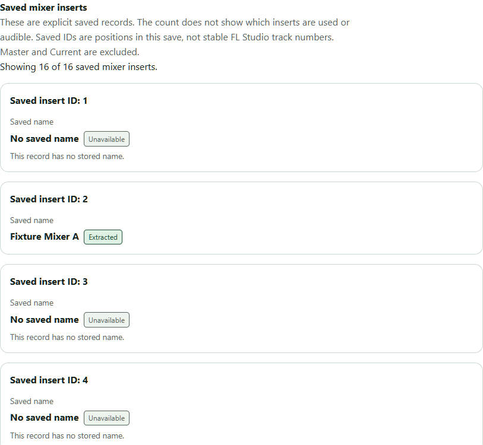
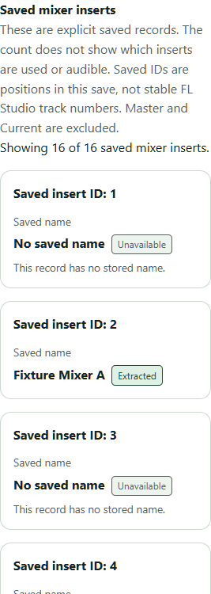
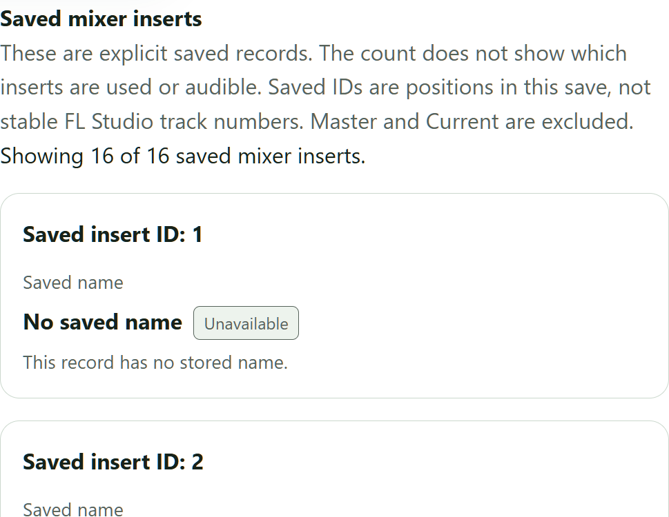

# Saved mixer inserts in project details

Issue [#304](https://github.com/guilhermebmichelin-create/fruitboard/issues/304)
completes the application slice after design PR297, approved F18-F21 corpus
PR299 and parser/full-validation PR301. Baseline is PR303 merge
`719cf51511b1e54b5e606cf1f1745c378e0e0d8b`.

## Meaning and behavior

New analysis stores qualified saved mixer insert count and name states in an
additive `mixerInserts` container within immutable private projection version 1.
Project details show **Saved mixer inserts** after saved patterns. The count
describes explicit saved records, without establishing usage, routing or
audibility. Saved IDs mean positions within this save, not persistent identities
or guaranteed FL Studio track numbers. Duplicate names retain separate entries.
Missing names show fixed explanations; no default labels are invented.

Only FL Studio **26.1.0.5530**'s independently qualified complete eighteen-record
layout is supported: sixteen ordinary positions 1-16, excluding Master/Current
at 0/17. No empty/zero, sparse layout, other builds, effects, routing, nested
plugins, automation or MIDI compatibility is added. Qualified results fit below
the twenty-entry disclosure threshold; constructed component-scale tests cover
disclosure focus without expanding accepted DTO layouts.

Older snapshots lacking the field remain readable and explain that a new
analysis is needed. Refresh reads existing results without queuing analysis or
rewriting snapshots. Missing sections, unadvertised fields, unverified builds/
layouts, ambiguity and exceeded limits retain fixed explanations. Malformed
present data fails the complete read. Loading, errors, changed/missing sources,
disabled roots and discarded late replies never retain an old count as current.

## Storage and authority

The container stores only validated count/name/status/coverage fields. Stored
reads reuse qualified parser validation with fixed ceilings, exact count,
ordered identities, text limits and paired state rules. The renderer validates
the selected DTO, build and identity set; names remain escaped inert text.
Existing source/root/fingerprint/publication/session/lease and details-read
guards remain the authority. No new command, permission, table, schema
migration, snapshot rewrite, file open, audio/MIDI or plugin capability is added.
Rejected publication preserves last-good immutable results. Older readers
ignore the additive field; rollback removes selection/display while retaining
snapshots.

## Validation and resource handoff

The complete pinned Windows `pnpm check` passed, including toolchain/SQLite/
privacy checks, formatting, lint, TypeScript, 131 repository-policy tests,
408 client tests, 536 workspace Rust tests and the optimized default desktop
build. Default/workspace and scanner/analysis-enabled desktop configurations
passed warning-denied Clippy; the enabled suites passed 118 and 159 tests,
respectively. Four supervised native-parser tests passed, including genuine
publication of all four approved mixer fixtures against independent registered
expectations. `pnpm audit --audit-level moderate` passed with one low advisory.

An independently retained, analysis-enabled NSIS package was built from
`01a907ad33fd0cd392556684f712b46c9ce39343` (tree
`e20cabddffb5615186803c8d073dbbc0b9604ec3`). The installed Windows app used
a fresh dedicated development identity and the genuine supervised parser;
no seeded database or personal profile was substituted. Its WebView2 version
was 154.0.4258.62. The following installed checks passed:

| Check                                              | Observed result                                                                                                                                 |
| -------------------------------------------------- | ----------------------------------------------------------------------------------------------------------------------------------------------- |
| All approved F18-F21 files                         | Exactly sixteen ordinary records, IDs 1-16; names and missing-name states match independent expectations; Master/Current excluded               |
| Refresh / explicit Analyze again                   | Refresh preserves snapshot and attempt count; explicit analysis creates a new snapshot and increments attempts                                  |
| Restart / uninstall and reinstall                  | Saved snapshot and attempt count survive; installers leave the review database byte-identical                                                   |
| Changed fingerprint / missing file / disabled root | Old details return no current result and hide mixer fields; restoring the owned file copy restores readable results                             |
| Loading / close / held late reply                  | Old mixer fields clear; keyboard close retains focus; late reply does not reopen details                                                        |
| Accessibility / layout                             | Mixer section has zero axe WCAG A/AA violations with contrast enabled at desktop, 390px viewport and 200% text; no horizontal document overflow |

The older, absent, unverified-layout, limit, malformed and held-reply renderer
cases were constructed transport responses. They demonstrate refusal, fixed
explanations and stale-response handling, not additional FLP compatibility.
Component-scale disclosure tests likewise do not qualify larger native layouts.
All nineteen approved source fixture hashes and both personal/Foundation Smoke
profile inventories remained unchanged. Only independent copies were renamed
or had timestamps changed. Both owned review installations were uninstalled,
their registration and host lock removed, and the review database retained.

### Installed screenshots

These are visible mixer-section captures from the actual installed app using
the approved named fixture. The 390px image is a narrow desktop viewport,
not a separate mobile-platform qualification. A screenshot-only reinstall used
the retained dedicated review profile and preserved its saved snapshot.

### Reuse and cleanup

The existing `desktop-feature-tests` validation cache is reused, owner
**Codex /root**; its absolute path is recorded in the private handoff.
Native builds run sequentially after preflight, keeping 30 GiB
free after expected output. Installed tests run alone under the shared host lock
after builds. Private evidence and independently copied binaries remain at
the private `library-mixer-inserts-20261010` evidence packet, outside caches.
The final installed cleanup measured 31.37 GiB free on the build/evidence
volume, above the 30 GiB reserve. No compiler intermediates were deleted;
reclaim from manual cache cleanup and its rebuild cost are both zero.
The cache remains reusable under its named owner. Independently copied
installer/main/parser/smoke binaries, provenance and hashes, checks, screenshots,
fixture copies and the review database must remain outside disposable caches.
Final head CI and owner review/manual merge remain required. No broader
Phase 3, resource, production activation, licensing or distribution acceptance
is implied.
